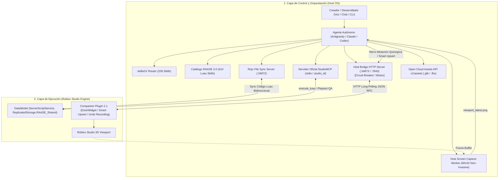

# robloxIA — Sistema Autónomo de Desarrollo para Roblox Studio (RAASE 3.0 Next-Gen)
### *Inspirado en el sistema "Generador de Robux 3000" (DEValen) y basado en estándares de ingeniería Luau 2026*

`robloxIA` (Roblox Autonomous Agent Studio Engine — **RAASE 3.0 Next-Gen**) es una arquitectura de desarrollo desatendido de grado de producción que convierte a cualquier agente de Inteligencia Artificial (Google Antigravity, Claude Code, OpenAI Codex, OpenCode, Cursor) en un **Ingeniero de Software y Diseñador Técnico Autónomo de Roblox Studio**.

El sistema traduce intenciones de alto nivel (vía voz, chat o terminal) en:
1. **Lógica autoritativa en Luau estricto (`--!strict`)** libre de vulnerabilidades y fugas de memoria mediante ciclo de vida con `Janitor`.
2. **Generación procedural y manipulación bidireccional del mundo 3D** en Roblox Studio (inspección, mutación quirúrgica y eliminación segura sincronizadas con `ChangeHistoryService`).
3. **Auditoría estética asistida por visión computacional con convergencia estricta de 2 pases** y cortacircuitos activo para erradicar bucles infinitos.
4. **Arquitectura transaccional de persistencia y cumplimiento DevEx 2026** (tasa preferencial U.S. 18+ de $0.0054 USD por Robux con avatares R15).

---

## 🏛️ Arquitectura del Sistema (RAASE 3.0 Next-Gen)



---

## 🌟 Novedades y Mejoras de RAASE 2.1 y 3.0 Next-Gen

### 1. Grafo de Escena Bidireccional (Introspección Total)
El puente ya no opera a ciegas. Dispone de primitivas RPC completas para consultar y modificar el árbol del juego:
* `GET_SCENE_GRAPH`: Inspecciona la jerarquía del `Workspace` o cualquier sub-modelo con filtrado por clase, profundidad máxima y volumen AABB.
* `INSPECT_OBJECT`: Extrae al instante la posición, tamaño, material, color, atributos, etiquetas de `CollectionService` y bounding box de cualquier instancia.
* `MODIFY_OBJECT`: Altera propiedades específicas *in situ* con registro atómico en `ChangeHistoryService` (soporta `Ctrl+Z`).
* `DELETE_OBJECT`: Destruye instancias específicas de forma segura.
* `CLEAR_ZONE`: Limpia volúmenes espaciales o modelos filtrados sin tocar el resto del mapa.

### 2. Spawning Atómico con Smart Upsert (Soberanía del Creador RN-10)
* `BATCH_SPAWN` procesa lotes de instancias en una única transacción atómica de red y un solo paso de historial (`ChangeHistoryService`), protegido por un límite de cuerpo de 25MB y cola con tope de 200 comandos (HTTP 503 ante saturación).
* **Smart Upsert Anti-Z-Fighting (RN-10)**: Por defecto opera en modo `skip_existing` para proteger las construcciones del usuario. Solo sobreescribe o actualiza partes existentes si se especifica explícitamente `upsert: true`.
* Soporte nativo para adjuntar automáticamente `SpecialMesh`, `ProximityPrompt`, `BillboardGui` y `Sound` 3D en el mismo despacho.

### 3. Cortacircuitos de Captura de Pantalla y Autenticación C1
* **Autenticación Bearer Obligatoria (C1)**: Toda comunicación HTTP con el bridge requiere cabecera `Authorization: Bearer <TOKEN>`. El token se genera criptográficamente al iniciar y se almacena en `bridge/.bridge_token` (o se define vía variable de entorno `ROBLOXIA_BRIDGE_TOKEN`). Para pruebas automatizadas sin tocar disco, definir `ROBLOXIA_NO_WRITE_TOKEN_FILE=1`.
* **Guardia en el Bridge:** Limita las capturas consecutivas a un máximo de **2**. Si un agente intenta tomar una 3ª captura consecutiva sin haber ejecutado una mutación real en la escena, el servidor responde con **HTTP 429 (`CIRCUIT_BREAKER_TRIGGERED`)**, deteniendo cualquier loop infinito.
* Solo los comandos de mutación real de escena (`BATCH_SPAWN`, `MODIFY_OBJECT`, `DELETE_OBJECT`, `CLEAR_ZONE`, `SET_TERRAIN_VOXELS`, `SET_LIGHTING`, `SPAWN_PART`, `CREATE_ISLAND`, `CSG_OPERATION`) reinician el contador a cero.
* Endpoint de desbloqueo manual seguro: `POST /api/capture/reset` (requiere confirmación explícita mediante cabecera `X-Manual-Reset: true` o query `?manual=true`).

### 4. Captura de Pantalla No Invasiva
* El worker de visión (`bridge/screen_capture.py`) ya no fuerza `SetForegroundWindow` ni `ShowWindow(SW_RESTORE)` incondicionalmente en cada cuadro. Solo restaura la ventana si está minimizada y no roba el foco del usuario mientras trabaja en Windows.

### 5. Panel DockWidget Nativo en Studio
* Interfaz desacoplable en Roblox Studio (`DockWidgetPluginGui`) con:
  * **Indicador LED de 4 estados**: 🟢 ONLINE (Port 34873), 🟣 BUSY (Executing Actuator), 🟡 PAUSED, 🔴 OFFLINE.
  * **Métricas en tiempo real**: Memoria RAM (MB), primitivas activas, instancias en Workspace y comandos ejecutados.
  * **Botones de acción rápida**: Pausar/Reanudar sondeo, Limpiar Props (`Clear Props`) y Test de Conexión (`Ping Bridge`).
  * **Activity Stream**: Consola de logs con marca de tiempo de cada orden recibida.

### 6. Catálogo Ampliado a 610 Habilidades (35 Dominios Técnicos + Extensiones 36/37/38)
Se consolidó el catálogo completo de 35 módulos formales bajo el estándar `agentskills.io` (235 núcleo de motor + 45 nivelación y arte + 330 sistemas de juego y plataforma avanzada), complementado con 19 skills metodológicas de ingeniería:
* **Dominios 01 a 10** (Skills 001-235): Núcleo de Luau estricto, redes Zero-Trust, persistencia, mundo 3D, cinemática, UI reactiva, audio, memoria y automatización.
* **Dominios 11 a 13** (Skills 236-280): Map making, modelado modular y efectos visuales VFX.
* **Dominios 14 a 35** (Skills 281-610): Pathfinding de NPCs, input contextual, chat y voz espacial, analíticas, monetización avanzada, pipelines CI/CD con TestEZ, moderación, física moderna, cámaras cinemáticas, Parallel Luau con Actors, internacionalización, optimización de streaming, accesibilidad, matchmaking, internals de DataModel, animación R15, avatares y layered clothing, combate volumétrico, interacciones seguras, colaboración en equipo, integraciones de red/secretos y Audio API 2026.

### 7. Evolución Next-Gen RAASE 3.0: Los 4 Módulos Maestros y Playtest QA en Bucle Cerrado
* **Coexistencia Rojo + `StudioMCP` + `MCPBridge` (`bridge/mcp_doctor.mjs` y `mcp_config.example.json`)**:
  * Todo código Luau persistente reside en `project_template/src/` y es sincronizado por **Rojo** (`default.project.json` -> `ReplicatedStorage.RAASE_Shared`, `ServerScriptService.RAASE_Server`, `StarterPlayerScripts.RAASE_Client`).
  * Prohibido mutar `.Source` en contenedores Rojo desde `execute_luau`; `StudioMCP` (`stdio`, usando ruta absoluta a `mcp.bat` en Windows y enrutamiento `studio_id` vía `list_roblox_studios`) requiere e invoca declarativamente los Módulos Maestros.
* **Pipeline 3D con Color Garantizado y Open Cloud (`bridge/open_cloud.mjs` y `blender_export_example.py`)**:
  * Exportación headless desde Blender con `apply_deterministic_transforms` (`1 stud = 0.28 m`), `bake_materials_to_vertex_colors` (`BYTE_COLOR`/`CORNER`), `map_uv_to_palette_atlas` (colapso de islas UV a escala `(0, 0)` sobre paleta $16 \times 16$) y `validate_mesh_budget` (`< 20,000` triángulos).
  * Ingesta vía Open Cloud Assets API (`POST /assets/v1/assets`) soportando `.glb` (`model/gltf-binary`), `.fbx` (`model/fbx`), `.mp3`/`.ogg` y `.png`, con bloqueo preventivo de `.rbxm` externos.
* **Firmas Exactas de los 4 Módulos Maestros (`ReplicatedStorage.RAASE_Shared`)**:
  1. **`VoxelTerrainBuilder`** (`project_template/src/shared/VoxelTerrainBuilder.luau`):
     * `VoxelTerrainBuilder.GenerateFBM(config)` (`Region3:ExpandToGrid(4)`, ruido Perlin FBM de 4–6 octavas, ocupancia fraccional continua $\in [0, 1]$, materiales automáticos `Rock`, `Sand`, `Grass`, `Snow`, `Water`).
     * `VoxelTerrainBuilder.CarveRoadPath(points, widthStuds, roadMaterial?)` (`ReadVoxels` / `WriteVoxels`).
  2. **`WorldAssembler`** (`project_template/src/shared/WorldAssembler.luau`):
     * `WorldAssembler.PlaceGrounded(model, position, options?)` (`workspace:Raycast` vertical hacia abajo + `GetExtentsSize().Y / 2` + `AlignToSlope` opcional + snapping a grilla).
     * `WorldAssembler.SmartUpsert(parent, template, name, targetPosition, options?)` (respeta `RAASE_Locked == true` bajo `RN-10`).
  3. **`ProceduralAnimator`** (`project_template/src/shared/ProceduralAnimator.luau`):
     * `ProceduralAnimator.AttachIK(character, config)` (`IKControl` nativo + `BallSocketConstraint` con `LimitsEnabled = true` para jugador local, héroes y bosses; para hordas masivas mantener `Motor6D.Transform`).
     * `ProceduralAnimator.CreateSpring2D(omega0?, zeta?, initialPosition?)` ($\zeta \in [0.45, 0.75]$).
     * `ProceduralAnimator.CreateFlipbookController(imageLabel, columns, rows, frameWidthPx, frameHeightPx, fps?)`.
  4. **`VFXAndJuiceEngine`** (`project_template/src/shared/VFXAndJuiceEngine.luau`):
     * `VFXAndJuiceEngine.CastEffect(effectType, cframe, scale?, options?)` (5 capas: `CoreFlash` + `ShockwaveRing` + `SlashBeam` `FaceCamera = false` + `DirectionalSparks` `VelocityParallel`/`Squash = -1.5` + `VoxelDebris` con `Raycast` al suelo).
     * `VFXAndJuiceEngine.AddTrauma(amount)` ($S = T^3$ en `Enum.RenderPriority.Camera.Value + 1`), `VFXAndJuiceEngine.TriggerHitFlash(targetModel, duration?)` (`Highlight` blanco `0.1 -> 1.0` en `0.12s`), `VFXAndJuiceEngine.ApplyHitstop(character, frames)` y `VFXAndJuiceEngine.PlayModulatedSound(...)` ($\pm 9\%$ pitch + knockback).
* **Protocolo de Playtest QA en Bucle Cerrado**:
  * Toda tarea de gameplay concluye ejecutando en `StudioMCP`: `start_stop_play` -> `character_navigation` -> `user_keyboard_input`/`user_mouse_input` -> `get_console_output` (0 errores) -> `screen_capture` (bajo cortacircuitos `RN-11` de máx. 2 pasadas) -> `start_stop_play`.

---

## 🛠️ Historial de Bugs Corregidos (Changelog de Estabilidad)

| Fallo / Síntoma | Causa Técnica | Solución Implementada en RAASE 2.1 / 3.0 |
| :--- | :--- | :--- |
| **Error en `SET_LIGHTING` (`RobloxScript capability`)** | Intentar escribir `Lighting.Technology` directamente lanzaba un error fatal de permisos de seguridad en el hilo del plugin. | Todas las propiedades de `Lighting` ahora se ejecutan dentro de bloques `pcall`, aplicando iluminación, sombras, reloj y atmósfera de forma segura. |
| **Parpadeo en falso de "🔴 OFFLINE" tras cada comando** | `updateStatusUI()` mutaba `connectionStatus = "BUSY"`. Al terminar el comando (`isBusy = false`), la UI no encontraba el estado `"ONLINE"` y caía en la rama `else` (OFFLINE) hasta el siguiente tick. | Se separó la salud de la red (`connectionStatus`) del estado de ejecución (`isBusy`). La UI muestra `🟣 BUSY` y regresa fluidamente a `🟢 ONLINE` sin parpadear en rojo. |
| **Bloque de pasto gigante no seleccionable que tapaba caminos** | El agente generó un bloque de **Terreno Voxel** (`workspace.Terrain`), el cual no se puede seleccionar con la herramienta estándar de ratón ni borrar como una pieza normal, y sus colinas tapaban los caminos a `Y = 0.15`. | Se vació el bloque voxel con material `Air` y se sustituyó por una pieza normal (`BasePart`) llamada `Plaza_Lawn_Selectable` a `Y = -0.5`. Es 100% seleccionable, editable y borrable con el ratón o la tecla Supr. |
| **Cursor del ratón trabado al mover cámara con clic derecho** | `FOCUS_CAMERA` modificaba `Camera.CFrame` pero dejaba `Camera.Focus` desfasado. Al dar clic derecho, el controlador de órbita de Studio regresaba el cursor violentamente al punto antiguo. | Se sincronizó de forma obligatoria `Camera.Focus = CFrame.new(center)` en cada reubicación de cámara, manteniendo la órbita del ratón en perfecta sincronía. |
| **Re-creación no deseada de objetos borrados por el usuario** | El agente re-ejecutaba scripts monolíticos completos que sobreescribían los cambios manuales del creador. | **Regla RN-10 (Soberanía del Creador)**: Prohibición estricta de re-crear o restaurar objetos borrados por el usuario sin orden textual directa, y uso exclusivo de micro-mutaciones quirúrgicas. |
| **Bucle infinito de capturas (30 min de fotos sin cambios)** | El prompt permitía auto-perfección abierta y el bridge no limitaba capturas consecutivas. | **Cortacircuitos en el Bridge** (bloqueo con HTTP 429 a la 3ª captura consecutiva) + **Regla RN-11 de 2 Pases** (parada obligatoria tras la verificación). |

---

## 📁 Estructura del Repositorio

```
robloxIA/
├── bridge/                         # Servidor local de enlace Host <-> Studio y Doctor MCP
│   ├── server.mjs                  # Servidor HTTP REST + Long-Polling + Cortacircuitos (:34873)
│   ├── mcp_doctor.mjs              # Doctor de coexistencia StudioMCP + MCPBridge + Rojo + Open Cloud
│   ├── screen_capture.py           # Capturador host-side de Viewport no invasivo
│   ├── open_cloud.mjs              # Conector de subida a Roblox Open Cloud API (.glb / .fbx / .mp3 / .png)
│   ├── test_mcp_doctor.mjs         # Tests unitarios de StudioMCP y soberanía Rojo
│   ├── test_open_cloud.mjs         # Tests unitarios de Open Cloud y exportación Blender
│   ├── test_master_modules.mjs     # Tests de contratos de los 4 Módulos Maestros Luau
│   ├── test_bridge_v2_1.mjs        # Suite de pruebas unitarias e integración del bridge
│   ├── test_circuit_breaker.mjs    # Test automatizado del cortacircuitos de capturas
│   └── package.json                # Configuración npm del bridge
├── plugin/                         # Companion Plugin para Roblox Studio
│   ├── CompanionPlugin.server.luau # Luau estricto con DockWidget UI, Smart Upsert y Grafo RPC
│   └── default.project.json        # Configuración Rojo para compilar el plugin
├── project_template/               # Plantilla de juego Roblox de producción
│   ├── default.project.json        # Mapeo Rojo a DataModel
│   ├── wally.toml                  # Gestor de paquetes Wally (Janitor, Signal, Promise)
│   ├── selene.toml                 # Reglas de linter Selene
│   ├── stylua.toml                 # Reglas de formateo StyLua
│   └── src/
│       ├── server/                 # Scripts autoritativos en ServerScriptService
│       │   ├── NetworkSecurityService.luau # Token Bucket + Honeypots + Rate Limiting
│       │   ├── DataPersistenceService.luau # UpdateAsync + Session Locking transaccional
│       │   ├── MonetizationService.luau    # ProcessReceipt idempotente + DevEx 2026
│       │   ├── LobbyInteractionService.luau# Interacciones ProximityPrompt de tiendas y forjas
│       │   └── init.server.luau            # Bootstrap del servidor
│       ├── client/                 # Scripts en StarterPlayerScripts
│       │   ├── CharacterController.client.luau # Cinemática procedural Motor6D.Transform
│       │   └── HUDController.client.luau       # UI reactiva escalada sin distorsión
│       └── shared/                 # Módulos Maestros en ReplicatedStorage.RAASE_Shared
│           ├── Types.luau                  # Tipado estricto Luau 2026
│           ├── Janitor.luau                # Erradicación de fugas de memoria
│           ├── VoxelTerrainBuilder.luau    # Terreno FBM Perlin (4-6 octavas) + CarveRoadPath
│           ├── WorldAssembler.luau         # Ground-snapping por Raycast + SmartUpsert (RN-10)
│           ├── ProceduralAnimator.luau     # IKControl + BallSocketConstraint + Spring2D + Flipbooks
│           └── VFXAndJuiceEngine.luau      # VFX de 5 capas + Trauma Cúbico S=T^3 + Hit-Flash 0.12s
├── agent/                          # Herramientas del Agente Autónomo
│   ├── system_prompt.md            # Master System Prompt con reglas RN-10, RN-11 y 4 Módulos Maestros
│   ├── raase_skills.json           # Matriz indexada de las 610 micro-habilidades técnicas (35 dominios)
│   ├── orchestrator_cli.mjs        # CLI para canalizar comandos, inspección y visión
│   ├── fix_terrain_and_details.mjs # Utilidad de nivelación de terreno
│   └── generators/                 # Generadores procedurales de alto nivel y Blender headless
├── skills-roblox/                  # Especificación formal de skills (agentskills.io)
│   ├── roblox-11-map-making/       # Level Design y zonificación espacial
│   ├── roblox-12-model-maker/      # Modelado modular y doctrina dual Mesh-First
│   ├── roblox-13-vfx-maker/        # Partículas, vigas, estelas e iluminación
│   ├── roblox-36-asset-pipeline/   # Blender Vertex Colors + Palette Atlas UV + <20k tris
│   ├── roblox-37-vfx-combat-pipeline/ # Secuenciador de impacto y combate
│   └── roblox-38-env-vfx-craft/    # VFX ambiental por recetas
├── docs/                           # Documentación y Especificación Técnica
│   ├── RAASE_2_0_SPECIFICATION.md  # Blueprint arquitectónico formal 2.0
│   └── ARQUITECTURA_ROBLOX_IA_NEXTGEN.md # Especificación Next-Gen 3.0 y 6 puntos ciegos resueltos
├── mcp_config.example.json         # Plantilla MCP para StudioMCP oficial + MCPBridge + Rojo
├── PROJECT_TRACKER.md              # Ledger de estado del proyecto (skillsGV format)
├── AGENTS.md                       # Contratos maestros para agentes multi-CLI
├── CLAUDE.md                       # Reglas de desarrollo para agentes CLI
└── README.md                       # Documentación principal
```

---

## 🚀 Guía de Inicio Rápido (Setup en 4 Pasos)

### 1. Diagnosticar el Entorno MCP y Iniciar el Bridge
En una terminal:
```bash
node bridge/mcp_doctor.mjs
node bridge/server.mjs
```
`mcp_doctor.mjs` resuelve la ruta absoluta de `mcp.bat` para `StudioMCP` y verifica los mapeos de Rojo y credenciales Open Cloud. `server.mjs` escuchará en `http://127.0.0.1:34873` y guardará el token en `bridge/.bridge_token`.

### 2. Instalar el Companion Plugin y Configurar Token en Roblox Studio
* Abre **Roblox Studio**.
* Compila el plugin directamente en la carpeta de plugins locales de Studio usando Rojo:
  ```powershell
  rojo build plugin/default.project.json -o "$env:LOCALAPPDATA\Roblox\Plugins\RAASE_Companion.rbxm"
  ```
* En Studio, activa los permisos de red en: `Game Settings -> Security -> Allow HTTP Requests` (**Activado**).
* **Flujo de Autenticación de Token**:
  1. Copia el token generado desde la terminal o desde `bridge/.bridge_token`.
  2. En la ventana desacoplable **RAASE 2.1 — Autonomous Studio Engine**, ingresa el token cuando sea solicitado (el plugin lo almacena de forma persistente con `plugin:SetSetting`).
  3. El indicador LED cambiará a verde `🟢 ONLINE (Port 34873)`.

### 3. Sincronizar el Código Luau con Rojo
En otra terminal:
```bash
rojo serve project_template/default.project.json
```
En Studio, abre el plugin de Rojo y presiona **Connect**.

### 4. Usar la CLI del Orquestador y Suite de Tests
```bash
# Ejecutar todas las suites de verificación (16 tests)
node --test bridge/test_mcp_doctor.mjs bridge/test_open_cloud.mjs bridge/test_master_modules.mjs bridge/test_circuit_breaker.mjs bridge/test_bridge_v2_1.mjs

# Consultar estado y telemetría del bridge
node agent/orchestrator_cli.mjs status

# Inspeccionar el grafo de escena en Workspace (profundidad 1)
node agent/orchestrator_cli.mjs scene-graph workspace 1
```

---

## 🛡️ Estándares de Ingeniería Luau 2026

* **Strict Typing Obligatorio**: Todo script inicia con `--!strict`. Tipos nominales y estructurales explícitos con `export type ...`.
* **Seguridad Zero-Trust**: El cliente jamás declara daño o dinero. Todos los `RemoteEvent` validan tipos (`typeof()`), distancias espaciales (`.Magnitude <= 15`) y están protegidos por limitadores de tasa *Token Bucket* con señuelos *honeypots*.
* **Gestión de Memoria con Janitor**: Ningún `RBXScriptConnection` queda huérfano. Todo objeto destruido invoca `:Destroy()` formalmente.
* **Cinemática Dual (`IKControl` + `Motor6D.Transform`)**: `ProceduralAnimator.AttachIK` para héroes/bosses ($\le 12$ rigs) y `Motor6D.Transform` en `RenderStepped` para multitudes. Prohibido modificar `C0/C1` en bucles de tiempo de ejecución.
* **DevEx 2026 e Idempotencia**: `MarketplaceService.ProcessReceipt` persiste el `PurchaseId` en DataStore mediante `UpdateAsync()` antes de otorgar beneficios. Exclusividad de avatares R15 para calificar a la tasa preferencial U.S. 18+ ($0.0054 por Robux).
* **Soberanía del Creador (RN-10)**: Las modificaciones manuales del usuario en Studio son ley. Ningún agente puede re-crear partes eliminadas ni sobreescribir decisiones de diseño sin autorización expresa.

---

## 📚 Catálogo de Habilidades (610 Skills en 35 Dominios Técnicos + 3 Extensiones)

> **Extensiones RAASE 3.0** (fuera del registry JSON): `roblox-36-asset-pipeline` (pipeline Blender Vertex Colors + Palette Atlas UV → Open Cloud `.glb`/`.fbx`), `roblox-37-vfx-combat-pipeline` (VFX de combate estilo fighting-game promovido a `VFXAndJuiceEngine.luau`) y `roblox-38-env-vfx-craft` (VFX ambiental por recetas: antorchas, agua, clima, magia). Portabilidad de modelo/harness: `docs/HARNESS-PORTABILITY.md` + `adapters/`.

Consulta la matriz canónica en [agent/raase_skills.json](file:///c:/Users/j1347/Desktop/Proyectos%20programacion/trabajos/IA%20INTEGRADA%20CON%20ROBLOX%20STUDIO/robloxIA/agent/raase_skills.json) y el índice general en [skills-roblox/roblox-engineer/SKILL.md](file:///c:/Users/j1347/Desktop/Proyectos%20programacion/trabajos/IA%20INTEGRADA%20CON%20ROBLOX%20STUDIO/robloxIA/skills-roblox/roblox-engineer/SKILL.md).
