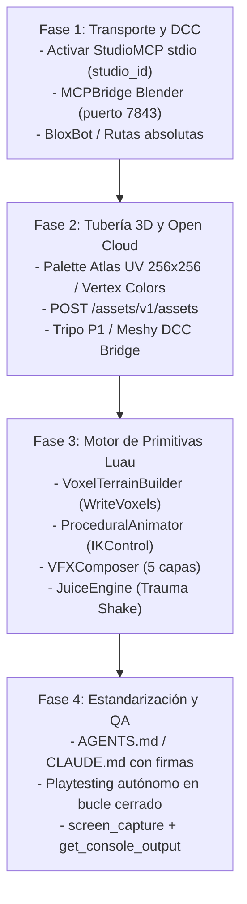

# Arquitectura de Próxima Generación para Agentes de IA en Roblox Studio
> **Superando las Limitaciones de Plugins Locales hacia Pipelines Multimodales de Modelado 3D, Map Making, Animación, VFX y Game Feel**  
> *Documento de especificación técnica y de ingeniería de sistemas agénticos para Roblox Studio (Edición 2026).*

> **Documento histórico — 2026-11-03.** Se conserva como propuesta, no certificación vigente. Sus conteos de herramientas y afirmaciones de formatos/importación fueron sustituidos por el [plan actual](PLAN_MAESTRO.md) y [AGENTS.md](../AGENTS.md). Descubrir capacidades instaladas; no ejecutar sus recetas como autorización.

---

## 📑 Tabla de Contenidos
1. [Diagnóstico Arquitectónico: El Fin de los Puentes HTTP Locales](#1-diagnóstico-arquitectónico)
2. [Matriz de Decisión Estratégica: Qué Descartar, Conservar y Rediseñar](#2-matriz-de-decisión-estratégica)
3. [Infraestructura Base: Servidor MCP Oficial y Orquestación Multi-Cliente](#3-infraestructura-base)
4. [Dominio 1: Modelos 3D Colorizados e Ingesta Automatizada](#4-dominio-1-modelado-3d-colorizado)
5. [Dominio 2: Map Making y Vóxeles Matemáticos](#5-dominio-2-map-making-y-vóxeles)
6. [Dominio 3: Animación 3D/2D, Cinemática Inversa y Dinámica de Resortes](#6-dominio-3-animaciones-3d-y-2d)
7. [Dominio 4: VFX Multicapa y Composición Declarativa](#7-dominio-4-vfx-multicapa)
8. [Dominio 5: Game Feel ("Juice") y Bucle de Verificación Autónoma](#8-dominio-5-game-feel-juice-y-qa-autónomo)
9. [Hoja de Ruta de Implementación en 4 Fases](#9-hoja-de-ruta-de-implementación)
10. [Contratos de Módulos Luau para ReplicatedStorage](#10-contratos-de-módulos-luau)
11. [Directivas para Agentes (Instrucciones para Claude / Codex)](#11-directivas-para-agentes-claude--codex)
12. [Índice de Fuentes y Referencias Técnicas](#12-fuentes-y-referencias)

---

## 1. Diagnóstico Arquitectónico

### El Problema de los Conectores Caseros (NenoEDX/robloxIA)
Los adaptadores de escritorio convencionales que intentan conectar LLMs con Roblox Studio mediante un plugin local basado en sondeo HTTP (`HttpService:GetAsync` en bucle) producen resultados mediocres en tareas creativas complejas debido a cuatro fallos estructurales:

```
┌───────────────────────────────────────────────────────────────────────────┐
│                        ARQUITECTURA OBSOLETA (OPEN-LOOP)                  │
│                                                                           │
│   [LLM de Texto] ──(HTTP Polling)──> [Plugin Local] ──> [Exec Luau Crudo] │
│         ▲                                                    │            │
│         └─────────── (Ceguera Espacial: Sin Feedback) ───────┘            │
│             - Desconexiones en Playtest                                   │
│             - Endpoints de subida muertos (cookies .ashx)                 │
│             - Mallas grises sin UVs / deformadas                          │
│             - Modelos procedimentales adivinados                          │
└───────────────────────────────────────────────────────────────────────────┘
```

1. **Ceguera Espacial y Bucle Abierto (*Open-Loop Execution*):** El agente genera coordenadas tridimensionales (`Vector3`, `CFrame`) o scripts `bpy` en Blender sin capturar el viewport resultante ni validar colisiones, normales o escalas relativas en studs.
2. **Desajuste Severo de Abstracción:** Forzar a un LLM a escribir mallas vértice por vértice en Python o a calcular manualmente decenas de keyframes de `Motor6D.C0` y curvas `NumberSequence` lo obliga a adivinar matemáticas complejas en lugar de invocar **constructores procedimentales deterministas**.
3. **Fractura en la Ingesta de Activos:** La desconexión entre Blender y Studio provoca que las mallas queden atrapadas fuera del motor o se importen como mallas grises sin texturas y con colisiones rotas, debido a la falta de mapeo UV (Palette Atlas / Vertex Colors) y al uso obsoleto de endpoints manuales.
4. **Transporte de Red Casero Obsoleto:** Roblox Studio integró de forma nativa su propio servidor **Model Context Protocol (StudioMCP)** vía `stdio`, con autenticación `RobloxScriptSecurity`, enrutamiento multi-instancia (`studio_id`) y más de 20 herramientas oficiales. Además, los antiguos endpoints de subida basados en cookies (`Upload.ashx`, `UploadNewMesh`, `UploadNewAnimation`) quedaron definitivamente **deprecados y desactivados en abril de 2026** en favor de la API oficial **Roblox Open Cloud Assets API**.

---

## 2. Matriz de Decisión Estratégica

| Componente | Diagnóstico en Enfoques Antiguos | Acción Recomendada | Estándar Moderno / Solución 2026 |
| :--- | :--- | :--- | :--- |
| **Transporte Studio ↔ Agente** | Sondeo HTTP local; se cuelga al alternar entre Edit y Playtest. | **Descartar por completo** | **Official StudioMCP** vía `stdio` con parámetro `studio_id`, o clientes integrados como **BloxBot** (`paralov/app-bloxbot-ai`). |
| **Puente Blender (bpy)** | Scripts Python aislados sin contexto, mala topología y sin UVs. | **Reemplazar por MCP Unificado + Skill** | **MCPBridge** (`iamjrmh/mcpbridge`, puerto 7843) + reglas de escala UV física y Vertex Colors (`WildCake/roblox-blender-modelling`). |
| **Subida de Modelos y Animaciones** | Importación manual o endpoints heredados de cookies (rotos en abril 2026). | **Construir módulo automatizado Open Cloud** | **Open Cloud Assets API** (`POST /v1/assets`) para subir `.fbx`, `.glb`, `.rbxm`/`.rbxmx` e inserción directa con `insert_asset`. |
| **Map Making (Terreno)** | Colocación ciega de partes o `FillBlock` generando terreno escalonado y derretido. | **Librería Luau matemática para `execute_luau`** | `Terrain:WriteVoxels` con ruido Perlin multi-octava, cálculo de ocupación fraccional, raycasting de asentamiento y feedback con `screen_capture`. |
| **Animaciones, VFX y Game Feel** | El LLM intenta inventar rotaciones y curvas de partículas en cada prompt. | **Transformar el plugin en un Motor de Primitivas Declarativas** | Catálogo de plantillas en `ReplicatedStorage` (`component_compose`, `IKControl`, `Voxel-Particles`, `EZ Camera Shake` por trauma). |

> [!IMPORTANT]
> El valor de proyectos como `robloxIA` debe migrar: **no ser la capa de transporte**, sino convertirse en una **Librería de Primitivas y Runtime Engine en Studio** (siguiendo la arquitectura de *Universal Roblox AI Studio* de Cmmdx256), exponiendo APIs de alto nivel para que Claude, Codex, Gemini u OpenCode construyan experiencias de nivel profesional.

---

## 3. Infraestructura Base

### Arquitectura Multi-MCP de Producción

```
               ┌──────────────────────────────────────────────┐
               │         ORQUESTADOR DE IA (ESCRITORIO)       │
               │   Claude Code / Codex CLI / BloxBot (React)  │
               └──────┬────────────────────┬───────────┬──────┘
                      │                    │           │
       stdio (studio_id)       HTTP:7843   │           │ Open Cloud API
                      │                    │           │ (API Key / OAuth)
                      ▼                    ▼           ▼
        ┌─────────────────────────┐  ┌───────────┐ ┌──────────────────────┐
        │ Roblox Studio MCP       │  │ MCPBridge │ │ Roblox Open Cloud    │
        │ (Oficial nativo stdio)  │  │ (Blender) │ │ Assets API           │
        └─────────────┬───────────┘  └─────┬─────┘ └──────────┬───────────┘
                      │                    │                  │
                      │         Export .fbx / .glb            │
                      │ ◄─────────────────────────────────────┘
                      ▼
        ┌─────────────────────────┐
        │     ROBLOX STUDIO       │
        │  DataModel / Viewport   │
        └─────────────────────────┘
```

### Configuración de Clientes MCP (Claude Desktop / Cursor / VS Code)
> [!CAUTION]
> En Windows, **nunca** uses variables de entorno sin expandir como `%LOCALAPPDATA%` en el archivo de configuración JSON. Los parsers de varios clientes MCP fallan silenciosamente. Usa rutas absolutas.

Ejemplo de `mcp_config.json` / `claude_desktop_config.json`:
```json
{
  "mcpServers": {
    "Roblox_Studio_Official": {
      "command": "cmd.exe",
      "args": [
        "/c",
        "C:\\Users\\TU_USUARIO\\AppData\\Local\\Roblox\\mcp.bat"
      ]
    },
    "Blender_Bridge": {
      "command": "node",
      "args": [
        "C:\\MCPBridge\\mcp-server\\index.js"
      ]
    }
  }
}
```

### Alternativa Integrada: BloxBot
Para evitar configuraciones manuales de terminal, **BloxBot** (`paralov/app-bloxbot-ai`) es una aplicación Electron + OpenCode con licencia MIT que:
- Detecta e inicia automáticamente el binario MCP de Roblox Studio incluso tras actualizaciones corruptas de Windows.
- Admite llaves directas de Anthropic, OpenAI, Google Gemini, OpenRouter o login web de ChatGPT Plus/Pro para consumir cuota Codex sin costes adicionales.

---

## 4. Dominio 1: Modelado 3D Colorizado

Para lograr que los modelos 3D aterricen en Roblox listos para usar, estilizados y completamente colorizados en un solo intento, el sistema divide la generación en 3 vías:

```
                              ┌─────────────────────────┐
                              │  Requerimiento del 3D   │
                              └────────────┬────────────┘
                                           │
         ┌─────────────────────────────────┼────────────────────────────────┐
         │                                 │                                │
         ▼                                 ▼                                ▼
┌──────────────────┐             ┌──────────────────┐             ┌──────────────────┐
│ Vía A: Nativa    │             │ Vía B: Procedural│             │ Vía C: Orgánica  │
│ (StudioMCP)      │             │ (Blender + MCP)  │             │ (Image-to-3D)    │
├──────────────────┤             ├──────────────────┤             ├──────────────────┤
│ `generate_mesh`  │             │ `blender_exec`   │             │ Generador 2D +   │
│ `generate_model` │             │ Palette Atlas UV │             │ Tripo P1 / Meshy │
│ Segmentación 8p  │             │ Vertex Colors    │             │ Direct DCC Bridge│
│ Props rápidos    │             │ Armas / Modulares│             │ Mascotas / Chars │
└──────────────────┘             └──────────────────┘             └──────────────────┘
```

### Comparativa de Vías de Generación 3D

| Atributo | Vía A: Nativa (StudioMCP) | Vía B: Procedural (Blender + MCPBridge) | Vía C: Externa (Tripo P1 / Meshy) |
| :--- | :--- | :--- | :--- |
| **Herramientas Clave** | `generate_mesh`, `generate_procedural_model`, `generate_material`, `store_image`. | `blender_execute_python` (puerto 7843), Open Cloud `POST /v1/assets`, `insert_asset`. | Generador de imagen conceptual + Tripo P1 / Tripo Studio (DCC Bridge a Studio). |
| **Color y Textura** | Texturizado IA de Roblox Cloud o aplicación de `MaterialVariant` PBR. | **Escalado UV a área cero** sobre Palette Atlas PNG ($256 \times 256$) o **Vertex Colors** (`color_attributes`). | Textura horneada a partir de imagen 2D con prompt estilizado blocky/Roblox. |
| **Presupuesto y Límites** | Segmentación hasta en 8 partes nombradas (ej. chasis y ruedas). Cuota: 50 modelos/24h. | Máximo **20,000 triángulos** por malla para evitar decimación en Open Cloud. Archivos $\le 20\text{ MB}$. | Presupuesto nativo $< 5,000$ triángulos en Tripo P1 con *flat shading*. |
| **Caso de Uso Óptimo** | Mobiliario, props genéricos, vehículos segmentables inmediatos. | Arquitectura modular, armas, props low-poly de precisión geométrica. | Criaturas, personajes estilizados, avatares, mascotas, accesorios UGC. |

### Pipeline de Texturizado por Paleta en Blender (Sin Pintura Procedural)
> [!TIP]
> **Prohibido pintar texturas proceduralmente píxel por píxel con Python**. En su lugar, el script de Blender debe:
> 1. Cargar una plantilla `.blend` con un archivo PNG de paleta de colores ($256 \times 256$ píxeles).
> 2. Desplegar las UVs de las caras seleccionadas.
> 3. **Reducir las islas UV a un punto infinitesimal (`scale = (0, 0)`)** y trasladar las coordenadas $(u, v)$ exactamente al centro de la celda de color deseada. Esto elimina el sangrado de textura entre píxeles vecinos.
> 4. Alternativa sin texturas: escribir directamente en `mesh.color_attributes` (RGBA por vértice), el cual Open Cloud conserva nativamente al convertir a `MeshPart`.
> 5. Escala: Convertir unidades considerando que **$1\text{ stud} \approx 0.28\text{ metros}$**.

### Pipeline de Subida Automatizada por Open Cloud
Para evitar intervención manual en la ingesta:
1. Blender exporta `.fbx` o `.glb` localmente.
2. Un script en Node.js/Python ejecuta una petición HTTP POST multiparte:
   - **Endpoint:** `https://apis.roblox.com/assets/v1/assets`
   - **Headers:** `x-api-key: <OPEN_CLOUD_KEY>` (permisos `asset:read`, `asset:write`)
   - **Payload:** `assetType: "Model"`, archivo binario (`model/fbx` o `model/gltf-binary`).
3. El script consulta `operations/{operationId}` en bucle hasta recibir `"done": true`.
4. Extrae el `assetId` resultante e invoca la herramienta `insert_asset` de StudioMCP para colocarlo en el `Workspace`.

---

## 5. Dominio 2: Map Making y Vóxeles

### Partición Obligatoria de Responsabilidades
- **Terreno Voxel (`workspace.Terrain`):** Exclusivamente para volúmenes orgánicos naturales (montañas, colinas, valles, cavernas, costas, cuerpos de agua).
- **Partes y MeshParts:** Exclusivamente para estructuras artificiales (edificios, pavimentos, aceras, muros, puentes). Nunca usar terreno para modelar arquitectura.

### Generación Matemática con `WriteVoxels`
> [!WARNING]
> No usar `FillBlock` o `FillBall` para crear terrenos extensos: produce colinas artificiales en escalera y congela el hilo principal. Usar siempre `workspace.Terrain:WriteVoxels`.

1. **Alineación a la Cuadrícula:** Cada vóxel de terreno mide exactamente **$4 \times 4 \times 4\text{ studs}$**. Toda `Region3` debe alinearse previamente usando `:ExpandToGrid(4)`.
2. **Ruido Perlin Fractal (FBM):** Superponer entre 4 y 6 octavas de `math.noise` determinista:
   $$\text{Altura}(x, z) = \sum_{i=0}^{N-1} \left(\frac{1}{2}\right)^i \cdot \text{noise}\left(2^i \cdot x \cdot s + \text{seed}, \, 2^i \cdot z \cdot s + \text{seed}\right)$$
3. **Ocupación Fraccional:** Para eliminar terrazas y obtener pendientes suaves, calcular el valor de ocupación $\text{occupancy} \in [0, 1]$ de la celda superficial según la distancia a la superficie calculada.
4. **Asignación Geométrica de Materiales:**
   - Pendiente $> 45^\circ$: `Enum.Material.Rock`
   - Cota de agua ($y \le \text{WaterLevel}$): `Enum.Material.Sand`
   - Superficie plana ($y > \text{WaterLevel}$): `Enum.Material.Grass`
5. **Vaciado de Carreteras:** Al trazar calles sobre el terreno, calcular las celdas de 4 studs debajo de la carretera y vaciarlas con `ReadVoxels`/`WriteVoxels` para evitar que la hierba o las rocas perforen el asfalto.

### Ensamblaje Modular y Bucle Visual Cerrado
1. **Raycast Snap-to-Grid:** Para colocar árboles, rocas y edificios sin que queden flotando o enterrados, lanzar un `workspace:Raycast` vertical hacia abajo y fijar `Model:PivotTo(CFrame.new(hitPosition))`.
2. **Validación Perceptual:** El agente debe cerrar el ciclo invocando `screen_capture` de StudioMCP (especificando posición y vector `lookAt`) para comprobar la iluminación y escala antes de proseguir.

---

## 6. Dominio 3: Animaciones 3D y 2D

### Animación 3D Procedural en Tiempo Real: `IKControl`
En lugar de generar listas estáticas de keyframes para acciones interactivas, se debe instanciar la clase nativa `IKControl` en el `Humanoid` o `AnimationController` del personaje:

| Propiedad | Tipo de Dato | Función en el Solver |
| :--- | :--- | :--- |
| `Type` | `Enum.IKControlType` | `Transform` (posición + rotación 6DOF), `Position`, `Rotation` o `LookAt`. |
| `ChainRoot` | `BasePart` / `Bone` | Eslabón superior de la cadena cinemática (ej. `LeftUpperArm`). |
| `EndEffector` | `BasePart` / `Bone` / `Attachment` | Extremo final que alcanza el objetivo (ej. `LeftHand`). |
| `Target` | `BasePart` / `Attachment` | Punto espacial que el `EndEffector` persigue dinámicamente cada fotograma. |
| `SmoothTime` | `number` | Tiempo de interpolación para amortiguar jitter o vibraciones. |
| `Weight` | `number` ($\in [0, 1]$) | Factor de mezcla sobre las animaciones de locomoción base. |

> [!TIP]
> Añadir restricciones mecánicas como `HingeConstraint` o `BallSocketConstraint` con `LimitsEnabled = true` en las articulaciones para impedir dobleces antinaturales en codos y rodillas.

### Animaciones de Cuerpo Entero (Mocap / Generación IA)
- **Plugin Nativo de Studio:** `NoCapMocap` (Motion Lab AI) permite generar animaciones R15 a partir de texto o video directamente en Studio.
- **Plataformas Externas:** Krikey AI y DeepMotion Animate 3D con retargeting automático a rigs R15 de Roblox.
- **Publicación:** Exportar como archivo `.rbxm` y subir mediante Open Cloud Assets API (`POST /assets/v1/assets` con `assetType: "Animation"`).

### Animaciones 2D y Dinámica de Resortes (UI / Flipbooks)
- **Spritesheets:** Generar cuadros sobre fondo plano, procesar con script de recorte (`chroma.py` o `pixel-art-lab`), subir en lote con `upload_image` de StudioMCP y animar mediante `ImageRectOffset` e `ImageRectSize`.
- **Dinámica de Resortes para UI:** Las transiciones de interfaces no deben usar simples interpolaciones lineales. Deben implementarse mediante ecuaciones diferenciales de oscilador armónico amortiguado:
  $$\ddot{x} + 2\zeta\omega_0\dot{x} + \omega_0^2(x - x_{\text{target}}) = 0$$
  Configurar en régimen subamortiguado ($\zeta \in [0.45, 0.75]$) para lograr un rebote natural y elástico en popups, barras de salud y notificaciones.

---

## 7. Dominio 4: VFX Multicapa

Un efecto visual de calidad profesional en Roblox **nunca se compone de un único ParticleEmitter**. Debe orquestarse en **5 capas complementarias**:

```
                               ┌────────────────────────────────┐
                               │     EVENTO DE IMPACTO / VFX    │
                               └───────────────┬────────────────┘
                                               │
       ┌───────────────────┬───────────────────┼───────────────────┬───────────────────┐
       ▼                   ▼                   ▼                   ▼                   ▼
┌──────────────┐    ┌──────────────┐    ┌──────────────┐    ┌──────────────┐    ┌──────────────┐
│ 1. Core Flash│    │2. Shockwave  │    │3. Slash Trail│    │ 4. Sparks    │    │ 5. Debris    │
├──────────────┤    ├──────────────┤    ├──────────────┤    ├──────────────┤    ├──────────────┤
│ PointLight + │    │ MeshPart /   │    │ Trail / Beam │    │ Orientation= │    │ Cubos Voxel  │
│ Emit(1..3)   │    │ Tween Quart  │    │ FaceCam=false│    │ VelParallel  │    │ Raycast color│
│ t = 0.15s    │    │ t = 0.25s    │    │ LightEmiss=1 │    │ Squash = -1.5│    │ Trayectoria  │
└──────────────┘    └──────────────┘    └──────────────┘    └──────────────┘    └──────────────┘
```

### Especificación de las 5 Capas de VFX

| Capa del Efecto | Instancias Nativas | Parámetros Matemáticos y Comportamiento |
| :--- | :--- | :--- |
| **1. Destello Inicial (*Core Flash*)** | `Attachment` + `ParticleEmitter` + `PointLight` | `Rate = 0`, ráfaga instantánea `:Emit(1)` a `:Emit(3)`. `LightEmission = 1`, `Brightness = 3`. `Size` en `NumberSequence` crece de 0 a 8 studs en $t=0.1\text{ s}$ y cae a 0 en $t=0.2\text{ s}$. `PointLight` se atenúa con `TweenService` en $0.15\text{ s}$. |
| **2. Onda de Choque (*Shockwave Ring*)** | `MeshPart` (Anillo o esfera hueca) o `ParticleEmitter` | Expansión radial acelerada con `TweenInfo.new(0.25, Enum.EasingStyle.Quart, Enum.EasingDirection.Out)`. `Transparency` interpola de 0.1 a 1.0. |
| **3. Estela Direccional (*Slash / Trail*)** | Par de `Attachments` + `Trail` o `Beam` curvo | `FaceCamera = false` para mantener volumen tridimensional. `LightEmission = 1`, `WidthScale` decreciente hacia la cola y `Transparency` con gradiente en ambos extremos. |
| **4. Chispas de Velocidad (*Directional Sparks*)** | `ParticleEmitter` | `Orientation = VelocityParallel`. Factor de estiramiento `Squash = -1.5`. `Drag = 4` para frenado aerodinámico. `Acceleration = Vector3.new(0, -50, 0)`. Disparo por ráfaga `:Emit(25)`. |
| **5. Escombros Voxel (*Voxel Debris*)** | `Part` / `Voxel-Particles` | Pequeños cubos de $0.5$ a $1.5\text{ studs}$. Mediante `Raycast` leen el `Material` y `Color` de la superficie impactada y se proyectan en arco con desvanecimiento y encogimiento final. |

---

## 8. Dominio 5: Game Feel ("Juice") y QA Autónomo

### Mecánicas del Controlador de Feedback Sensorial (`JuiceEngine`)

```
   [Acción / Impacto]
           │
           ├───► 1. Camera Shake (Trauma T³ con Ruido Perlin en RenderStep)
           ├───► 2. Hit-Stop (AnimationTrack.Speed = 0.02 durante 40-60ms + FOV Pulse)
           ├───► 3. Hit-Flash (Highlight blanco puro, FillTransparency 0.1 → 1.0 en 0.12s)
           └───► 4. Audio Pitch Variation (PlaybackSpeed ±9% + Knockback físico)
```

1. **Sacudida de Cámara por Trauma (Modelo EZ Camera Shake en Luau):**
   - El controlador mantiene una variable escalar de trauma $T \in [0, 1]$.
   - Se incrementa por evento ($+0.25$ en golpe leve, $+0.65$ en explosión) y decae linealmente en cada fotograma ($\dot{T} = -\lambda$).
   - La magnitud de la sacudida $S$ sigue una curva no lineal cúbica: $S = T^3$.
   - Conectado a `RunService:BindToRenderStep` con prioridad `Enum.RenderPriority.Camera.Value + 1`:
     $$\Delta \theta_{\text{pitch}} = \theta_{\max} \cdot T^3 \cdot \text{noise}(t \cdot f, \, \text{seed}_1), \quad \Delta \theta_{\text{roll}} = \theta_{\max} \cdot T^3 \cdot \text{noise}(t \cdot f, \, \text{seed}_2)$$
2. **Hit-Stop (Congelación de Fotogramas):**
   - Al impactar, reducir la velocidad de la animación activa (`AnimationTrack:AdjustSpeed(0.02)`) durante **40 a 60 milisegundos**, restaurándola luego a 1.0.
   - Aplicar un pulso elástico momentáneo en `Camera.FieldOfView` ($\pm 2^\circ$).
3. **Hit-Flash Lumínico:**
   - Instanciar un `Highlight` sobre el modelo impactado: `FillColor = Color3.new(1, 1, 1)`, `FillTransparency = 0.1`, `OutlineTransparency = 1`.
   - Desvanecer a transparencia 1.0 en $0.12\text{ segundos}$ mediante `TweenService` y destruirlo.
4. **Variación Acústica e Impulso:**
   - Variar aleatoriamente `Sound.PlaybackSpeed` en un rango de $\pm 9\%$ para evitar fatiga auditiva.
   - Aplicar un impulso físico instantáneo en la raíz del enemigo (`RootPart:ApplyImpulse(knockbackVector)`).

### Bucle de Verificación Autónoma (Playtesting MCP)
Un agente nunca debe considerar concluida su tarea en modo *Edit*. Debe ejecutar el ciclo de validación interactiva:
1. Iniciar simulación con `start_stop_play` de StudioMCP (o delegar al subagente de playtesting).
2. Desplazar al personaje a la zona de prueba mediante `character_navigation`.
3. Simular pulsaciones e interacciones de combate usando `user_keyboard_input` y `user_mouse_input`.
4. Inspeccionar la consola con `get_console_output` verificando ausencia de errores y advertencias en tiempo de ejecución.
5. Capturar fotogramas reales de la acción con `screen_capture` para confirmar visualmente el resultado.

---

## 9. Hoja de Ruta de Implementación



---

## 10. Contratos de Módulos Luau

Para que los agentes de IA no inventen código matemático crudo, se deben desplegar cuatro módulos maestros en `ReplicatedStorage.Modules`:

### 1. `VoxelTerrainBuilder`
```lua
-- ReplicatedStorage.Modules.VoxelTerrainBuilder
local VoxelTerrainBuilder = {}

export type TerrainConfig = {
    RegionMin: Vector3,
    RegionMax: Vector3,
    Scale: number,
    Octaves: number,
    WaterLevel: number,
    Seed: number,
}

function VoxelTerrainBuilder.GenerateFBM(config: TerrainConfig)
    -- Alinea región con :ExpandToGrid(4)
    -- Muestrea 4 a 6 octavas de math.noise
    -- Asigna ocupación fraccional y materiales (Rock, Sand, Grass)
    -- Escribe por chunks con workspace.Terrain:WriteVoxels
end

function VoxelTerrainBuilder.CarveRoadPath(points: { Vector3 }, widthStuds: number)
    -- Vacía celdas de 4 studs bajo calzadas usando ReadVoxels/WriteVoxels
end

return VoxelTerrainBuilder
```

### 2. `ProceduralAnimator`
```lua
-- ReplicatedStorage.Modules.ProceduralAnimator
local ProceduralAnimator = {}

function ProceduralAnimator.AttachIK(character: Model, limbName: string, targetAttachment: Attachment): IKControl
    -- Instancia y configura IKControl con ChainRoot, EndEffector y SmoothTime
end

function ProceduralAnimator.CreateSpringUI(guiElement: GuiObject, targetProps: { [string]: any })
    -- Aplica oscilador armónico subamortiguado (zeta = 0.55) para rebote de UI
end

return ProceduralAnimator
```

### 3. `VFXComposer`
```lua
-- ReplicatedStorage.Modules.VFXComposer
local VFXComposer = {}

export type VFXPreset = "Slash" | "Impact" | "GroundSlam" | "AuraBurst"

function VFXComposer.CastEffect(preset: VFXPreset, position: Vector3, normal: Vector3, colorPalette: { Color3 })
    -- Instancia coordinada de las 5 capas:
    -- 1. Core Flash (PointLight + Emit)
    -- 2. Shockwave Ring (Tween Quart)
    -- 3. Slash Trail (LightEmission=1, FaceCamera=false)
    -- 4. Directional Sparks (VelocityParallel, Squash=-1.5)
    -- 5. Voxel Debris (Cubos con material y color vía Raycast)
end

return VFXComposer
```

### 4. `JuiceEngine`
```lua
-- ReplicatedStorage.Modules.JuiceEngine
local JuiceEngine = {}

function JuiceEngine.AddTrauma(amount: number)
    -- Incrementa trauma T in [0, 1]
    -- Ejecuta sacudida cubica S = T^3 en RenderStep con math.noise
end

function JuiceEngine.ApplyHitStop(animationTrack: AnimationTrack, durationSeconds: number)
    -- Reduce speed a 0.02 durante 40-60ms y pulsa Camera.FieldOfView
end

function JuiceEngine.TriggerHitFlash(targetModel: Model)
    -- Highlight temporal blanco puro con desvanecimiento de 0.12s
end

return JuiceEngine
```

---

## 11. Directivas para Agentes (Claude / Codex / Antigravity) y Verificación de Producción 2026

### 11.1 Los 6 Puntos Ciegos Técnicos Resueltos en `robloxIA` (RAASE 3.0)

Durante la auditoría cruzada de la investigación teórica contra el código real del repositorio (`robloxIA`) y la especificación oficial de Roblox 2026, se identificaron y corrigieron **6 puntos ciegos críticos**:

| # | Punto Ciego Detectado en la Teoría | Realidad Técnica en Producción (2026) | Solución Implementada en `robloxIA` (RAASE 3.0) |
| :--- | :--- | :--- | :--- |
| **1** | **Colisión de Fuente de Verdad: Rojo vs. `StudioMCP`** | Si el agente modifica `.Source` de scripts en Studio vía `execute_luau` mientras Rojo (`default.project.json`) está activo, Rojo sobrescribe los cambios o desincroniza Git. | **Soberanía de Rojo (`checkRojoSovereignty` en `bridge/mcp_doctor.mjs`)**: Todo módulo persistente vive en `project_template/src/` en disco; `StudioMCP` (`execute_luau`) solo los invoca vía `require(ReplicatedStorage.RAASE_Shared.<Modulo>)`. |
| **2** | **Mezcla de nombres de herramientas MCP (Oficial vs. Comunidad)** | El servidor oficial `StudioMCP` expone exactamente **10 herramientas** (y requiere `studio_id` obtenido con `list_roblox_studios`). Herramientas como `insert_asset`, `generate_procedural_model`, `store_image` o `upload_image` pertenecen a wrappers comunitarios (`Cmmdx256/Roblox-Studio-MCP`) y fallan si el agente las invoca contra `StudioMCP`. | **Catálogo Verificado (`OFFICIAL_STUDIO_MCP_TOOLS`)**: Para insertar un `assetId` subido por Open Cloud se usa `execute_luau` con `InsertService:LoadAsset(assetId)` o `MCPBridge` (`BUILD_BATCH`). |
| **3** | **Límites reales de Open Cloud `POST /assets/v1/assets` y `.rbxm`** | Open Cloud acepta `.glb` (`model/gltf-binary`) y `.fbx` (`model/fbx`) con tope duro de **20,000 triángulos** y **20 MB**, pero rechaza archivos `.rbxm` / `.rbxmx` sintetizados fuera de Roblox Studio. | **`bridge/open_cloud.mjs` + `blender_export_example.py`**: Soporte nativo `.glb` y `.fbx`, bloqueo preventivo de `.rbxm` externos y guardia `< 20,000` triángulos antes de subir. |
| **4** | **Duplicación con `impact_sequencer.luau` (`roblox-37`)** | El repositorio ya poseía `impact_sequencer.luau` con hitstop seguro ante re-entrada, FOV punch con token y pools de flipbooks. | **Promoción a `VFXAndJuiceEngine.luau`**: Conserva las guardias de concurrencia y añade cámara de trauma cúbico ($S = T^3$), Hit-Flash (`Highlight` blanco $0.12\text{ s}$), pitch de audio $\pm 9\%$ y `CastEffect` de 5 capas. |
| **5** | **Presupuesto de CPU de `IKControl` vs. `Motor6D.Transform`** | Activar `IKControl` con solver FABRIK/CCD en cada frame sobre hordas de 50+ NPCs degrada el frame time del cliente. | **Política Dual en `ProceduralAnimator.luau`**: `AttachIK` (`IKControl` + `BallSocketConstraint` con `LimitsEnabled = true`) para jugador local, héroes y bosses ($\le 12$ rigs); `Motor6D.Transform` trigonométrico para multitudes/hordas. |
| **6** | **Descartar `CompanionPlugin` frente a `execute_luau` crudo** | Enviar miles de líneas imperativas a `execute_luau` consume tokens y pierde la protección de ediciones manuales del creador. | **Coexistencia Híbrida**: Se mantiene `CompanionPlugin` + `WorldAssembler.SmartUpsert` (`RN-10`) junto con `StudioMCP` para Playtest QA (`start_stop_play`, `character_navigation`, `get_console_output`). |

### 11.2 Contratos Maestros en `CLAUDE.md` y `AGENTS.md`

```markdown
### Reglas Inquebrantables de Ejecución en Roblox (RAASE 3.0)
1. SOBERANÍA ROJO: NUNCA edites `.Source` de scripts dentro de `RAASE_Shared`, `RAASE_Server` o `RAASE_Client` vía `execute_luau`. Escribe los módulos en `project_template/src/` e invócalos con `require(game:GetService("ReplicatedStorage").RAASE_Shared.<Modulo>)`.
2. TERRENO Y ARQUITECTURA: NUNCA uses `Terrain:FillBlock` para arquitectura; usa `VoxelTerrainBuilder.GenerateFBM(config)` y `VoxelTerrainBuilder.CarveRoadPath(points, widthStuds)` para terreno orgánico (`ExpandToGrid(4)`, ocupancia fraccional [0, 1]).
3. ENSAMBLADO DE MUNDOS: NUNCA dejes props flotando; usa siempre `WorldAssembler.PlaceGrounded(model, position, options)` o `WorldAssembler.SmartUpsert(parent, template, name, pos, options)` (respetando `RAASE_Locked` bajo RN-10).
4. ANIMACIÓN PROCEDURAL: NUNCA alteres `Motor6D.C0/C1` en bucles de ejecución. Usa `ProceduralAnimator.AttachIK(character, config)` (`IKControl` + límites anatómicos `BallSocketConstraint`) para héroes/bosses, `ProceduralAnimator.CreateSpring2D(omega0, zeta)` ($\zeta \in [0.45, 0.75]$) para UI/cámara y `ProceduralAnimator.CreateFlipbookController(...)` para spritesheets 2D.
5. VFX DE 5 CAPAS Y GAME FEEL: NUNCA instancies un `ParticleEmitter` aislado para un impacto; invoca `VFXAndJuiceEngine.CastEffect(effectType, cframe, scale, options)` (CoreFlash + ShockwaveRing + SlashBeam `FaceCamera=false` + DirectionalSparks `VelocityParallel`/`Squash=-1.5` + VoxelDebris con `Raycast` al suelo + Trauma Cúbico $S=T^3$ + Highlight Hit-Flash 0.12s + Audio $\pm 9\%$ pitch).
6. QA EN BUCLE CERRADO (PLAYTEST): Toda tarea de gameplay concluye ejecutando en `StudioMCP`:
   - `list_roblox_studios` (obtener `studio_id`)
   - `start_stop_play` (iniciar Playtest)
   - `character_navigation` y simulación de entrada (`user_keyboard_input` / `user_mouse_input`)
   - `get_console_output` (verificando 0 errores en tiempo de ejecución)
   - `screen_capture` (máximo 2 pases bajo el cortacircuitos `RN-11`)
```

---

## 12. Fuentes y Referencias

1. *I Built a Roblox Game Using Only AI Agents — Here's What Happened*, [Medium](https://medium.com/@andy.a.g/i-built-a-roblox-game-using-only-ai-agents-heres-what-happened-ed57b553facc)
2. *MCPBridge — Roblox Studio Plugin as MCP Client*, [GitHub](https://github.com/iamjrmh/mcpbridge)
3. *Roblox Studio MCP Server*, [LobeHub](https://lobehub.com/mcp/chrrxs-robloxstudio-mcp)
4. *Open Cloud Upload Support for More Asset Types*, [Roblox DevForum](https://devforum.roblox.com/t/open-cloud-upload-support-for-more-asset-types/4022082)
5. *Roblox Terrain Generation — WriteVoxels vs FillBlock*, [Picoo](https://picoo.io/how-to-make/roblox-terrain-generation)
6. *AGENTS.md Template for Roblox AI*, [GitHub dnouri/roblox-pi-template](https://github.com/dnouri/roblox-pi-template/blob/main/AGENTS.md)
7. *Free AI Roblox 3D Model Maker*, [3D AI Studio](https://www.3daistudio.com/UseCases/Roblox)
8. *WildCake GitHub Repositories (roblox-blender-modelling, Voxel-Particles-Plugin)*, [GitHub](https://github.com/WildCake)
9. *Universal Roblox AI Studio by Cmmdx256*, [Glama](https://glama.ai/mcp/servers/Cmmdx256/Roblox-Studio-MCP)
10. *Usage Guide for Assets | Open Cloud*, [Roblox Creator Hub](https://create.roblox.com/docs/cloud/guides/usage-assets)
11. *New Open Cloud Meshes Decimated Compared To Legacy API*, [Roblox DevForum](https://devforum.roblox.com/t/new-open-cloud-meshes-decimated-compared-to-ones-uploaded-with-legacy-api/4588202)
12. *BloxBot — AI Agent Desktop App for Roblox*, [BloxBot.ai](https://bloxbot.ai/) / [GitHub paralov/app-bloxbot-ai](https://github.com/paralov/app-bloxbot-ai)
13. *Connect to Roblox Studio MCP Server | Documentation*, [Roblox Creator Hub](https://create.roblox.com/docs/studio/mcp)
14. *Studio MCP: Multi-Agent Improvements and Connected AI Clients*, [Roblox DevForum](https://devforum.roblox.com/t/studio-mcp-multi-agent-improvements-and-connected-ai-clients/4820583)
15. *Connect Codex & Claude to Roblox Studio (MCP Guide)*, [Hobbias](https://hobbias.com/resources/connect-codex-claude-roblox-studio-mcp)
16. *AssetReuploader V4.0*, [Roblox DevForum](https://devforum.roblox.com/t/assetreuploader-v40-easy-plugin-for-transferring-animations-images-and-meshes-between-creators/3555922?page=2)
17. *How to Connect Claude Desktop to Roblox Studio Using MCP*, [Medium](https://ridwansuryantara.medium.com/how-to-connecting-claude-desktop-to-roblox-studio-using-mcp-b2de3c203e7b)
18. *RoCode vs BloxBot*, [RoCode](https://www.rocode.app/rocode-vs-bloxbot)
19. *The Complete Guide to Connecting Roblox and AI to Build Games*, [Note.com](https://note.com/kamiumi_ai/n/n20e2a7a2a4a8?hl=en)
20. *Assistant for Studio Guide*, [Roblox Creator Hub](https://create.roblox.com/docs/assistant/guide)
21. *Open Cloud Assets API Reference & Decimation Limits*, [Roblox DevForum](https://devforum.roblox.com/t/introducing-open-cloud-assets-api/2245171?page=2)
22. *Procedurally Generated World Using Roblox Terrain*, [Roblox DevForum](https://devforum.roblox.com/t/infinite-procedurally-generated-world-using-roblox-terrain/4179544)
23. *Roblox World Building Claude Skill*, [Skills Directory](https://www.skillsdirectory.com/skills/el4cteo-roblox-world-building)
24. *IKControl Documentation*, [Roblox Creator Hub](https://create.roblox.com/docs/reference/engine/classes/IKControl)
25. *NoCapMocap Motion Lab: AI Animation Plugin*, [Roblox Creator Store](https://create.roblox.com/store/asset/133601709278915/NoCapMocap-Motion-Lab-AI-Animation-Plugin)
26. *Krikey AI Custom Roblox Animations*, [Krikey AI](https://www.krikey.ai/es/integrations/custom-roblox-animations)
27. *DeepMotion Animate 3D V3.5 Roblox Support*, [DeepMotion](https://deepmotion.com/post/animate-3d-v3-5-roblox-vroid-support-jump-animations-more)
28. *EZ Camera Shake Ported to Roblox*, [Roblox DevForum](https://devforum.roblox.com/t/ez-camera-shake-ported-to-roblox/98482)
29. *Camera Position Priority*, [Roblox DevForum](https://devforum.roblox.com/t/camera-position-priority/1061876)
